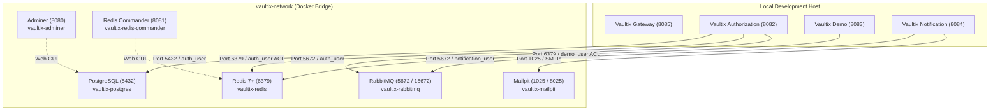

# Vaultix Infrastructure

[](https://docs.docker.com/compose/)
[](https://www.postgresql.org/)
[](https://redis.io/)
[](https://www.rabbitmq.com/)
[](https://github.com/axllent/mailpit)
[](https://opensource.org/licenses/Apache-2.0)

Containerized local development infrastructure for the **Vaultix** distributed platform, orchestrated via **Docker Compose** on an isolated bridge network with persistent named volumes and health check dependencies.

---

## Architecture & Services Matrix



---

## Service Endpoints & Credentials

| Service | Container Name | Host Port | Internal Port | Description | Web UI / Access | Default Credentials |
| :--- | :--- | :---: | :---: | :--- | :--- | :--- |
| **PostgreSQL** | `vaultix-postgres` | `5432` | `5432` | Primary relational database (`postgres:alpine`) | Connect via psql / GUI | `postgres` / `postgres` |
| **Redis** | `vaultix-redis` | `6379` | `6379` | Cache, token blacklist, & pub/sub (`redis:alpine`) | Connect via redis-cli | Password: `redis` (root) |
| **RabbitMQ** | `vaultix-rabbitmq` | `5672`, `15672` | `5672`, `15672` | AMQP broker & Management UI (`rabbitmq:management-alpine`) | [http://localhost:15672](http://localhost:15672) | `admin` / `admin_password` |
| **Mailpit** | `vaultix-mailpit` | `1025`, `8025` | `1025`, `8025` | Zero-config local SMTP server & inbox UI | [http://localhost:8025](http://localhost:8025) | No authentication |
| **Adminer** | `vaultix-adminer` | `8080` | `8080` | Lightweight PostgreSQL web management console | [http://localhost:8080](http://localhost:8080) | System: `PostgreSQL`, Server: `postgres` |
| **Redis Commander** | `vaultix-redis-commander` | `8081` | `8081` | Web management console for Redis keyspaces | [http://localhost:8081](http://localhost:8081) | HTTP Basic: `admin` / `admin` |

---

## Documentation Index

Step-by-step provisioning guides, Redis ACL definitions, and RabbitMQ declarative imports are maintained in the [`docs/`](docs/) directory:

| Document | Description |
| :--- | :--- |
| 📖 [**Microservice Provisioning & Setup Guide**](docs/PROVISIONING.md) | Exhaustive instructions for PostgreSQL database & dedicated user creation, Redis ACL user setups (`auth_user`, `demo_user`), declarative RabbitMQ definition import (`definitions.json`), Spring Boot connection settings, and MaxMind GeoLite2 installation. |

---

## Quickstart

### 1. Environment Configuration
Verify that each service subfolder possesses an active `.env` file (copied from `.env.example`):
- `adminer/.env`
- `postgres/.env`
- `redis/.env`
- `redis-commander/.env`
- `rabbitmq/.env`
- `mailpit/.env`

### 2. Starting Infrastructure
From the `infra/` directory:
```bash
docker compose up -d
```
Or from the repository root:
```bash
docker compose -f infra/docker-compose.yml up -d
```

### 3. Verifying Health Status
Check that all containers reach `healthy` status:
```bash
docker compose ps
```

### 4. Stopping Infrastructure
* **Preserve persistent database and message data (Standard daily stop)**:
  ```bash
  docker compose down
  ```
* **Full reset & wipe all storage volumes (`postgres_data`, `redis_data`, `rabbitmq_data`, `mailpit_data`)**:
  ```bash
  docker compose down -v
  ```

---

## Directory Structure

```text
infra/
├── docker-compose.yml                         /* Container orchestration & network definitions */
├── .gitignore                                 /* Ignores sensitive .env and GeoIP binary files */
├── README.md                                  /* Infrastructure runbook and overview */
├── docs/
│   └── PROVISIONING.md                        /* Comprehensive provisioning & ACL guide */
├── adminer/
│   ├── .env                                   /* Adminer port configuration */
│   └── .env.example
├── postgres/
│   ├── .env                                   /* PostgreSQL root credentials */
│   ├── .env.example
│   ├── init-auth-db.sql                       /* Authorization service DB & user initialization */
│   └── service-db-template.sql                /* Template for provisioning new microservice databases */
├── redis/
│   ├── .env                                   /* Redis root password */
│   ├── .env.example
│   ├── init-auth-acl.txt                      /* Authorization service ACL user setup */
│   ├── init-demo-acl.txt                      /* Demo resource server ACL user setup */
│   └── service-acl-template.txt               /* Template for new microservice ACL users */
├── redis-commander/
│   ├── .env                                   /* Redis Commander HTTP auth credentials */
│   └── .env.example
├── rabbitmq/
│   ├── .env                                   /* RabbitMQ admin credentials */
│   ├── .env.example
│   ├── definitions.json                       /* One-click declarative schema import */
│   ├── init-auth-rabbitmq.txt                 /* Authorization service exchange instructions */
│   ├── init-notification-rabbitmq.txt         /* Notification service queue & binding setup */
│   └── service-rabbitmq-template.txt          /* Template for microservice queue/exchange setup */
├── mailpit/
│   ├── .env                                   /* Mailpit SMTP & UI port configuration */
│   └── .env.example
└── geoip/
    ├── .gitkeep                               /* Tracks directory in git */
    └── GeoLite2-City.mmdb                     /* MaxMind GeoIP2 City database (placed locally) */
```

---

## Volume Persistence Reference

All persistent state is stored in Docker-managed named volumes:
* `postgres_data` &rarr; Bound to `/var/lib/postgresql` in `vaultix-postgres`.
* `redis_data` &rarr; Bound to `/data` (includes `/data/users.acl`) in `vaultix-redis`.
* `rabbitmq_data` &rarr; Bound to `/var/lib/rabbitmq` in `vaultix-rabbitmq`.
* `mailpit_data` &rarr; Bound to `/data` in `vaultix-mailpit`.

---

## Next Steps

To provision the databases, Redis ACL accounts, and RabbitMQ exchanges for the microservices, see:

👉 [**Microservice Provisioning Guide (docs/PROVISIONING.md)**](docs/PROVISIONING.md)
